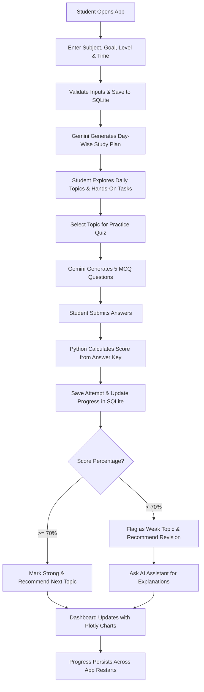

# AI Personalized Learning Coach 🎓

[](https://www.python.org/)
[](https://streamlit.io/)
[](https://aistudio.google.com/)
[](https://www.sqlite.org/)
[](LICENSE)

An intelligent, adaptive educational web application engineered for the **AI Engineering Internship (Xpert Champs)**. The AI Personalized Learning Coach generates personalized, structured, day-wise learning curriculums using **Google Gemini API**, delivers interactive topic-based quizzes with strictly verified **Python scoring**, diagnoses weak concepts (< 70%), delivers adaptive study recommendations, and provides a 24/7 context-aware AI tutor with persistent **SQLite** storage.

---

## 🌟 Key Features

1. **Intelligent Learner Setup (Module 2)**
   - Collects student name, subject, specific learning goal, knowledge level (*Beginner*, *Intermediate*, *Advanced*), target duration (1–90 days), daily study time (15–240 mins), and preferred learning style (*Reading*, *Examples*, *Practice*, *Mixed*).
   - Validates all inputs defensively before curriculum generation.
   - Preserves learner profiles persistently in SQLite with support for multi-profile switching.

2. **AI-Powered Day-Wise Study Plan (Module 3)**
   - Dynamically generated curriculum via Google Gemini (`gemini-2.5-flash`).
   - Every day includes topic title, learning objectives, key concepts, estimated minutes, practical hands-on activities, and revision tasks.
   - Interactive completion checkboxes updating learning progress in real-time.
   - Plan regeneration and direct 1-click quiz shortcuts on each topic card.

3. **Diagnostic Practice Quizzes (Module 4)**
   - 5 targeted multiple-choice questions dynamically generated per topic.
   - Clean interactive radio buttons with question-level difficulty tags (*Beginner*, *Medium*, *Hard*).
   - **Strict Python Scoring Engine:** Scores are calculated directly from the answer key in Python (`score = sum(1 for q in answers if correct)`). The LLM is never trusted to compute scores.
   - Instant feedback with detailed pedagogical explanations for both correct and incorrect choices.

4. **Adaptive AI Performance Analysis (Module 5)**
   - Configurable pedagogical performance tiers:
     - **< 40% (Needs Revision):** Flags topic for fundamental review and beginner drills.
     - **40% – 69% (Practice Recommended):** Recommends supplementary code examples and practice problems.
     - **70% – 89% (Good Progress):** Recommends moderate practice and advancing to next topic.
     - **90% – 100% (Strong Performance):** Recommends advancing to advanced challenge exercises.
   - Adheres to the principle: *Never claim full mastery based on a single small quiz alone.*

5. **24/7 Context-Aware Learning Assistant (Module 6)**
   - Conversational AI study companion powered by Gemini.
   - Context-aware of student's active subject, goal, knowledge level, and weak topics needing revision.
   - Quick-prompt chips for real-world analogies, annotated code walkthroughs, and error debugging.
   - Session chat history persistently preserved in SQLite.

6. **Interactive Progress Dashboard (Module 7)**
   - Interactive visualizations built with **Plotly**:
     - *Topic Completion Donut Chart* (completed vs. pending).
     - *Quiz Score Progression Line Chart* with a 70% benchmark target.
     - *Topic-Wise Performance Bar Chart* color-coded by strength and weakness.
   - 7 core real-time statistics queried directly from SQLite records (no hardcoded metrics).
   - Highlighting of identified weak topics (< 70%) and dynamic next priority milestone.

7. **Persistent Learning History & Archives (Module 8)**
   - Archive of all generated study plans with 1-click activation.
   - Historical quiz attempts with full question-level audit trails.
   - Milestone log of completed topics with completion timestamps.
   - Preserves complete learning state across application restarts.

---

## 🏗️ Architecture & Project Structure

```
ai-personalized-learning-coach/
│
├── app.py                      # Main landing page & application entrypoint (Module 1)
├── ai_service.py               # Gemini API client, structured JSON parsing & fallback generator
├── learning_plan.py            # Study plan generation, input validation & topic tracking (Module 3)
├── quiz_manager.py             # Quiz orchestration, Python scoring engine & submission recording (Module 4)
├── performance_analyzer.py     # Weak topic detection & adaptive tier recommendations (Module 5)
├── learning_assistant.py       # Context-aware conversational tutor & prompt pills (Module 6)
├── database.py                 # SQLite schema, CRUD operations & connection pool (Persistence Layer)
├── dashboard.py                # Plotly analytics, chart generators & metric cards (Module 7)
├── config.py                   # Theme palette (Lavender/Purple), thresholds & UI styles
├── seed_db.py                  # Database seeder for demo evaluation
├── test_app.py                 # Automated unit and integration test suite
├── requirements.txt            # Python dependencies
├── .env.example                # Sample environment configuration
├── .gitignore                  # Git ignore rules for virtualenvs, keys & caches
├── README.md                   # Project documentation
│
├── pages/
│   ├── 1_Learning_Profile.py   # Module 2: Learner Setup & Profile Management
│   ├── 2_Study_Plan.py         # Module 3: Day-Wise Study Plan & Topic Tracker
│   ├── 3_Practice_Quiz.py      # Modules 4 & 5: Practice Quiz & Performance Feedback
│   ├── 4_AI_Assistant.py       # Module 6: Conversational Learning Assistant
│   ├── 5_Progress_Dashboard.py # Module 7: Interactive Student Analytics Dashboard
│   └── 6_Learning_History.py   # Module 8: Archives & Question Inspections
│
├── assets/
│   ├── logo.svg                # Vector brand logo
│   └── logo.png                # High-res application brand icon
│
└── sample_data/
    └── example_learning_plan.json # Standard 7-day Python reference curriculum
```

---

## 🛠️ Technology Stack

| Technology | Purpose | Specification |
| :--- | :--- | :--- |
| **Python** | Core logic & scoring | Python 3.10+ (Tested up to Python 3.14) |
| **Streamlit** | User interface & navigation | v1.35.0+ |
| **Google Gemini API** | Curriculum, quizzes & assistant | `google-genai` SDK (`gemini-2.5-flash`) |
| **SQLite** | Persistent relational storage | Built-in `sqlite3` with foreign key enforcement |
| **Pandas** | Progress analysis & aggregations | v2.0.0+ |
| **Plotly** | Interactive dashboard visualizations | v5.20.0+ |
| **Python-Dotenv**| Secure API key loading | v1.0.0+ |

---

## 🚀 Getting Started

### 1. Clone the Repository
```bash
git clone https://github.com/your-username/ai-personalized-learning-coach.git
cd ai-personalized-learning-coach
```

### 2. Set Up a Virtual Environment
**On Windows (PowerShell):**
```powershell
python -m venv venv
.\venv\Scripts\Activate.ps1
```

**On macOS / Linux:**
```bash
python3 -m venv venv
source venv/bin/activate
```

### 3. Install Dependencies
```bash
pip install -r requirements.txt
```

### 4. Configure Google Gemini API Key
Create a `.env` file in the root directory:
```bash
copy .env.example .env     # On Windows
cp .env.example .env       # On Linux/macOS
```

Open `.env` and insert your Gemini API Key:
```env
GEMINI_API_KEY=AIzaSyYourActualGeminiApiKeyHere
```
> **Note:** A free Gemini API key can be obtained instantly at [Google AI Studio](https://aistudio.google.com/app/apikey).
> Alternatively, you can enter your API key directly inside the application's sidebar settings expander. If no API key is provided, the application runs in a high-fidelity **Offline/Demo Mode** with intelligent built-in curriculums and quizzes.

### 5. Seed Initial Data (Optional for Demo)
To pre-populate a sample Python learner (*Alex Johnson*) with a 7-day plan, sample quiz attempts, and chat history:
```bash
python seed_db.py
```

### 6. Run the Application
```bash
streamlit run app.py
```
Open your browser at `http://localhost:8501`.

---

## 🧪 Automated Testing

Run the automated test suite covering all functional requirements:
```bash
python -m unittest test_app.py -v
```

The test suite validates:
- [x] Learner profile creation and validation rules.
- [x] Rejection of empty subjects, goals, and out-of-range days/minutes.
- [x] Structured day-wise study plan generation.
- [x] Topic completion toggling and progress recording in SQLite.
- [x] 5-question multiple choice quiz schema validation.
- [x] **Python answer-key scoring engine** (exact percentage calculations without LLM dependency).
- [x] Adaptive recommendation tier boundaries (<40%, 40-69%, 70-89%, 90-100%).
- [x] Automatic identification of weak topics (< 70%).
- [x] Dashboard metric aggregation across database records.
- [x] Persistence of chat history across sessions.

---

## 📋 Complete Application Workflow



---

## 🔐 Database Schema

The application uses SQLite (`learning_coach.db`) with 7 relational tables:

1. `learners` — ID, name, subject, goal, knowledge level, target days, daily minutes, learning style, timestamps.
2. `study_plans` — ID, learner ID, subject, goal, total days, summary, is_active flag.
3. `study_topics` — ID, plan ID, day number, topic name, objectives, key concepts, estimated minutes, practical activities, revision tasks, is_completed, completed_at.
4. `quiz_attempts` — ID, learner ID, plan ID, topic ID, topic name, total questions, correct answers, score percentage, status, recommendation, timestamp.
5. `quiz_questions` — ID, attempt ID, question text, 4 options (A-D), correct option, student's selected option, is_correct, explanation, difficulty.
6. `learning_progress` — ID, learner ID, topic ID, status, last quiz score, needs_revision flag, attempts count, updated timestamp.
7. `chat_history` — ID, learner ID, role (user/assistant), message text, timestamp.

---

## 📤 Submission & GitHub Upload Instructions

To upload this project to your GitHub repository:

```bash
# Initialize git repository
git init

# Add all project files
git add .

# Commit files
git commit -m "Complete AI Personalized Learning Coach application"

# Link to your remote GitHub repository
git branch -M main
git remote add origin https://github.com/your-username/ai-personalized-learning-coach.git

# Push to GitHub
git push -u origin main
```

---

## 📄 License & Credits

- Developed for the **AI Engineering Internship Project Brief** (Xpert Champs).
- Built with Python, Streamlit, Google Gemini API, SQLite, Pandas, and Plotly.
- Distributed under the MIT License.

